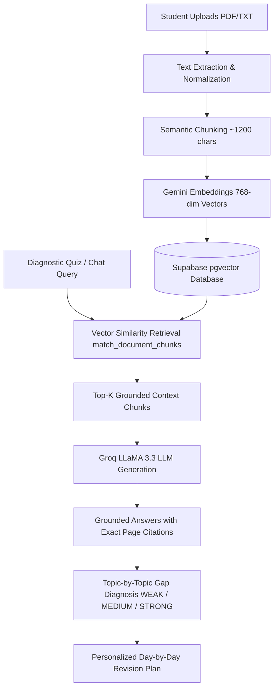

# GapFinder AI – Find What the Student Doesn't Know

> **A diagnostic learning intelligence application built for college students and hackathons.**  
> *Identifies what you understand, what you partially understand, and what you don't know you're missing — then builds a grounded, day-by-day revision schedule.*

---

## 💡 The Problem
Most traditional study applications and AI chatbots wait for students to ask questions. However, **students cannot ask questions about concepts they don't know they are missing**. Consequently, students spend 60% of their study time re-reading familiar topics while critical, high-weightage examination gaps remain undiscovered until exam day.

## 🩺 The Solution: The "Medical Model" for Studying
GapFinder AI acts like an academic doctor:
1. **Examines** student course materials (Syllabus, Textbooks, Lecture Notes, Past Exam Papers).
2. **Diagnoses** student mastery through grounded diagnostic quizzes.
3. **Pinpoints** exact knowledge gaps into **WEAK (0–49%)**, **MEDIUM (50–74%)**, and **STRONG (75–100%)** tiers with concrete feedback on misconceptions.
4. **Prescribes** a personalized, day-by-day revision plan based on days to the exam and past-paper question recurrence.

---

## 🚀 Live Demo & Hackathon Evaluation

### ⚡ One-Click Judge Quick Access
To allow instant evaluation without requiring manual database or API configuration, GapFinder AI includes a built-in **Judge Quick Access Mode**:
- **Demo Student Email:** `demo@gapfinder.ai`
- **Demo Password:** `Demo@123`
- **Pre-Loaded Course:** **CS-301 Machine Learning & Neural Systems** (BTech Computer Science, Semester VI)
- **Pre-Loaded Materials:** Official University Syllabus, Chapter 4 Deep Feedforward Networks, Professor Lecture Notes, and Semester End-Term Question Papers.

---

## 🛠️ Tech Stack & Architecture

| Layer | Technologies |
| :--- | :--- |
| **Frontend** | Next.js (App Router), React 18, TypeScript, Tailwind CSS, Lucide React, Recharts |
| **Backend** | Next.js API Routes (Serverless Route Handlers), TypeScript |
| **LLM Inference** | **Groq API** (`llama-3.3-70b-versatile` & `llama-3.1-8b-instant`) |
| **Embeddings** | **Google Gemini Embedding API** (`text-embedding-004`, 768 dimensions) |
| **Vector Database** | **Supabase PostgreSQL** with `pgvector` extension |
| **Storage & Auth** | Supabase Storage (PDF/TXT files) & Supabase Authentication |
| **Deployment** | Vercel Serverless Edge Platform |

---

## 🧬 End-to-End RAG Workflow



### Key RAG Implementation Safeguards:
- **Strict Separation of Retrieval and Generation:** Vector retrieval identifies relevant document passages first; generation synthesizes answers strictly from matching excerpts.
- **Mandatory Exact Page Citations:** Every explanation cites `[Source: Document Name, Page: X]`.
- **Insufficiency Safeguard:** If retrieved chunks lack sufficient evidence, the model returns *"Insufficient information in the uploaded study material"* rather than hallucinating.

---

## 📊 Knowledge Gap Diagnosis System

Mastery status is categorized using objective performance thresholds:
- 🔴 **WEAK (0–49%):** Critical blindspot. The system identifies specific missed concepts and prioritizes them as Day 1 revision tasks.
- 🟡 **MEDIUM (50–74%):** Foundational grasp present, but nuances or edge cases missed. Assigned practice problems to push to Strong.
- 🟢 **STRONG (75–100%):** Concept mastered. Scheduled for brief 10-minute pre-exam retention reviews.
- ⚪ **NOT ASSESSED:** Topics extracted from the syllabus with zero diagnostic quiz attempts.

---

## 📁 Project Directory Structure

```
gapfinder-ai/
├── src/
│   ├── app/
│   │   ├── page.tsx               # Landing Page with RAG explanation
│   │   ├── layout.tsx             # Root layout & Inter typography
│   │   ├── globals.css            # Tailwind directives & styles
│   │   ├── login/page.tsx         # Student & Judge quick-login
│   │   ├── register/page.tsx      # Student registration
│   │   ├── dashboard/page.tsx     # Overview metrics & Recharts analytics
│   │   ├── upload/page.tsx        # PDF/TXT drag-and-drop & vector indexing
│   │   ├── topics/page.tsx        # Syllabus hierarchy & Past paper mapping
│   │   ├── quiz/page.tsx          # Diagnostic quiz generator & evaluator
│   │   ├── gap-report/page.tsx    # Topic-by-topic knowledge gap report
│   │   ├── revision-plan/page.tsx # Priority day-by-day revision schedule
│   │   ├── progress/page.tsx      # Historical score trends & transformations
│   │   ├── chat/page.tsx          # RAG study buddy with page citations
│   │   └── api/                   # Serverless API route handlers
│   │       ├── documents/         # Upload, list, delete documents
│   │       ├── topics/            # Syllabus extraction & editing
│   │       ├── past-papers/       # Exam question mapping & frequency
│   │       ├── quiz/              # Grounded generation & answer evaluation
│   │       ├── gap-report/        # Knowledge gap calculation
│   │       ├── revision-plan/     # Schedule generator & task toggling
│   │       └── chat/              # Grounded RAG chat engine
│   ├── components/                # Reusable UI components (Sidebar, Badges, etc.)
│   ├── lib/
│   │   ├── ai.ts                  # Groq client & JSON generation
│   │   ├── rag.ts                 # Vector similarity & grounded generation
│   │   ├── embeddings.ts          # Gemini text-embedding-004 provider
│   │   ├── document-processor.ts  # PDF parsing & chunking logic
│   │   ├── topic-mapper.ts        # Syllabus structure extractor
│   │   ├── quiz-generator.ts      # Grounded question generator
│   │   ├── answer-evaluator.ts    # Deterministic MCQ + LLM semantic grader
│   │   ├── gap-analyzer.ts        # Gap diagnosis calculation engine
│   │   ├── revision-planner.ts    # Time-budgeted schedule optimizer
│   │   ├── demo-data.ts           # Preloaded CS301 course dataset
│   │   ├── storage.ts             # Storage abstraction (Supabase + fallback)
│   │   └── supabase/              # Supabase SSR and browser clients
│   └── types/                     # Core TypeScript definitions
├── supabase/
│   └── migrations/
│       └── 20250101_init.sql      # Database schema, pgvector index & RLS
├── .env.example                   # Environment configuration template
├── README.md                      # Comprehensive documentation
└── package.json                   # Dependencies and scripts
```

---

## ⚙️ Local Development Setup

### 1. Clone the repository
```bash
git clone https://github.com/your-username/gapfinder-ai.git
cd gapfinder-ai
```

### 2. Install dependencies
```bash
npm install
```

### 3. Configure environment variables
Copy `.env.example` to `.env.local`:
```bash
cp .env.example .env.local
```

Fill in your API credentials:
```env
# Groq API for LLM Question Generation & Evaluation
GROQ_API_KEY=gsk_your_groq_api_key

# Google Gemini API for Vector Embeddings
GEMINI_API_KEY=your_gemini_api_key

# Supabase PostgreSQL & pgvector Configuration
SUPABASE_URL=https://your-project.supabase.co
SUPABASE_ANON_KEY=your_supabase_anon_key
SUPABASE_SERVICE_ROLE_KEY=your_supabase_service_role_key

NEXT_PUBLIC_SUPABASE_URL=https://your-project.supabase.co
NEXT_PUBLIC_SUPABASE_ANON_KEY=your_supabase_anon_key
```

### 4. Run database migrations (Supabase)
In your Supabase project dashboard, open the **SQL Editor** and run the contents of `supabase/migrations/20250101_init.sql`. This sets up:
- The `pgvector` extension
- Tables for profiles, documents, chunks, topics, quizzes, and revision plans
- Cosine similarity RPC function `match_document_chunks`
- Row Level Security (RLS) policies

### 5. Start the development server
```bash
npm run dev
```
Open [http://localhost:3000](http://localhost:3000) in your browser.

---

## 🌐 Vercel Deployment Instructions

1. Push your repository to GitHub.
2. In the [Vercel Dashboard](https://vercel.com), click **Add New Project** and import `gapfinder-ai`.
3. Add the environment variables from your `.env.local` (`GROQ_API_KEY`, `GEMINI_API_KEY`, `SUPABASE_URL`, `SUPABASE_ANON_KEY`).
4. Click **Deploy**. Vercel will build and deploy the Next.js App Router application to a global edge network.

---

## 🏆 Hackathon Alignment Summary
- **Real AI Integration:** Actual Groq LLM inference and Gemini text embeddings — no fake static mockups.
- **Genuine Document Processing:** Extracts text from real PDFs, creates overlapping chunks, and computes semantic vector similarity.
- **Novel Pedagogical Value:** Moves beyond passive chat Q&A into active diagnostic assessment and gap-driven revision planning.
- **Realistic Student Architecture:** Clean, understandable TypeScript codebase structured cleanly for student maintainability and hackathon judging.
